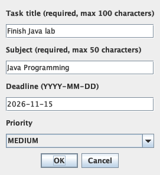
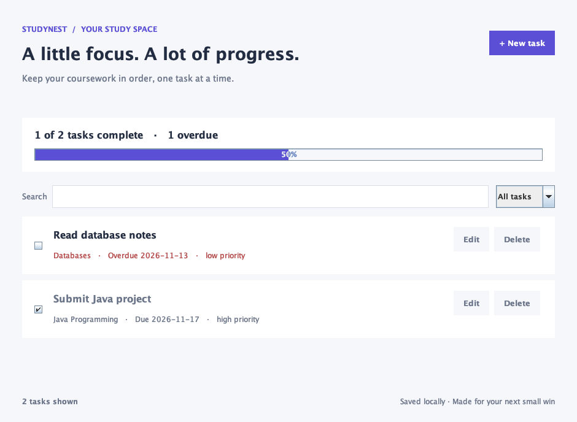

# StudyNest

A small Java desktop planner for coursework, with a clean lavender-and-white interface.

## Features

- Add assignments with a subject, deadline, and priority.
- Edit task titles, subjects, deadlines, and priorities using a prefilled form.
- Mark tasks complete or reopen them.
- Search by title or subject; filter by completion or overdue status.
- See completion progress and overdue counts.
- Delete tasks with confirmation.
- Automatically save changes to a local file and restore them on startup.

## Run

Install **JDK 17 or newer** (a JDK includes both `java` and `javac`). No Maven,
database, downloads of Java libraries, or internet connection are required to run the app.

From this project folder on macOS or Linux:

```sh
mkdir -p out
javac -encoding UTF-8 -d out src/studynest/*.java
java -cp out studynest.StudyNest
```

From Windows Command Prompt:

```bat
mkdir out
javac -encoding UTF-8 -d out src\studynest\*.java
java -cp out studynest.StudyNest
```

You can also open the folder in IntelliJ IDEA, Eclipse, or VS Code, select a
JDK 17+ project SDK, and run `StudyNest.main()`. A desktop environment is required.
Always run from the same project folder so the app finds the same data file.

### Homebrew Java on this Mac

If `java` says it cannot locate a runtime, the installed Homebrew JDK can be used directly:

```sh
/opt/homebrew/opt/openjdk@17/bin/javac -encoding UTF-8 -d out src/studynest/*.java
/opt/homebrew/opt/openjdk@17/bin/java -cp out studynest.StudyNest
```

## Screenshots

Actual Swing content captured during the integration checks. Native OS title bars
are omitted; sample task dates reflect the test day.

**Dashboard with overdue work and completion progress**


**Prefilled edit form**



**Restored tasks after starting a fresh Java process**



## Submission materials

- [Short project report](docs/REPORT.md): problem, classes, concepts, implementation, and limitations.
- [Viva preparation](docs/VIVA.md): explanations and rehearsal questions.
- [Testing record](docs/TESTING.md): coverage, actual logs, and repeatable commands.

## Project structure

```text
src/studynest/
  Task.java        Data model and priority enum
  TaskStore.java   File reading and writing
  StudyNest.java   Swing interface and application entry point
data/tasks.tsv    Created when you first save a task (excluded from Git)
```

## Concepts to explain in your course

| Concept | Where it appears |
| --- | --- |
| Classes and objects | Each assignment is a `Task` object |
| Encapsulation | Private task fields with public getters |
| Enum | Three fixed priority choices |
| Collections | Tasks stored in an `ArrayList` |
| File handling | UTF-8 data loaded and saved by `TaskStore` |
| Exception handling | Invalid dates, unreadable files, and save failures |
| Event-driven programming | Buttons, checkbox actions, live search |
| Streams and comparators | Filtering, sorting, and completion counts |
| Separation of responsibilities | Model, persistence, and interface in separate classes |

Tasks are sorted by completion status, then deadline, then priority. Overdue means
an unfinished task with a deadline before today. Tasks due today are not overdue.
The file uses Base64 for text fields to support Unicode and delimiter characters;
this is encoding, not encryption. Run only one instance at a time because storage
is a simple local file without multi-user synchronization.

## Suggested demonstration

1. Add “Finish Java lab” under “Java Programming”, with tomorrow's deadline and high priority.
2. Add an assignment with yesterday's deadline to show the overdue filter.
3. Search for a subject and clear the search again.
4. Complete one assignment and show the progress bar updating.
5. Close and reopen the app to demonstrate persistence.
6. Delete a task and demonstrate the confirmation dialog.

## Verification checklist

- Blank titles and subjects are rejected.
- Impossible dates such as `2026-02-30` are rejected.
- Completing and reopening a task updates counts and filters.
- Search ignores capitalization.
- Tasks survive restarting the application.
- Cancelling a task or deletion leaves the list unchanged.
- Editing preserves the task's completion status and saves changes across restarts.
- Cancelling an edit leaves the original details unchanged.

Verified on 14 November 2026 using Homebrew OpenJDK 17.0.21 on macOS: compilation,
30 feature/storage assertions, and 3 fresh-process restart assertions passed.
See the testing record for evidence and remaining manual checks.
